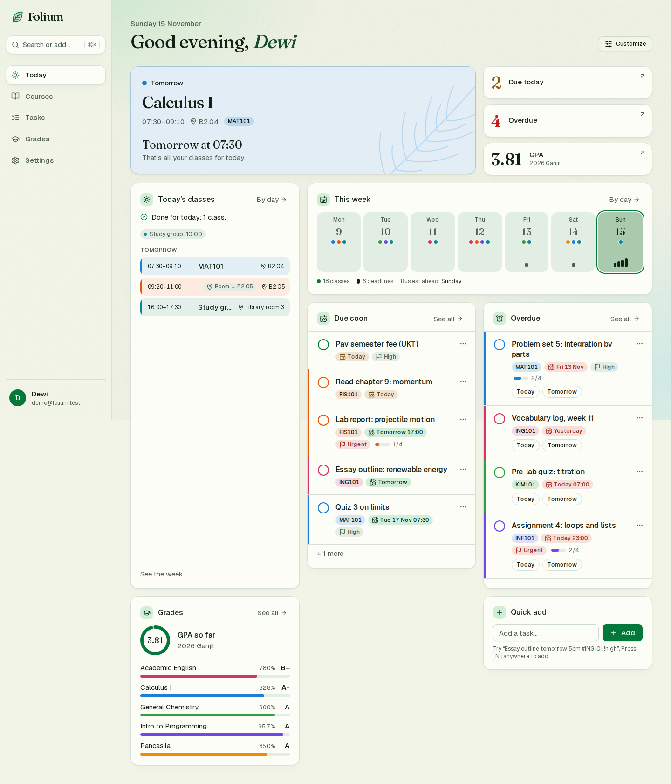
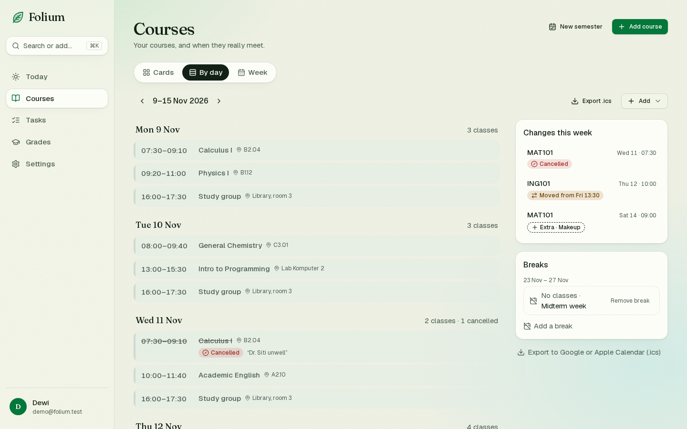
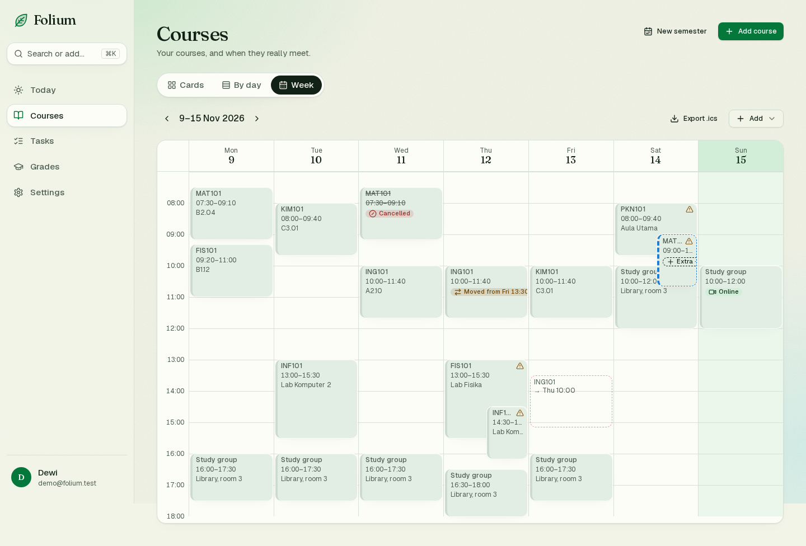
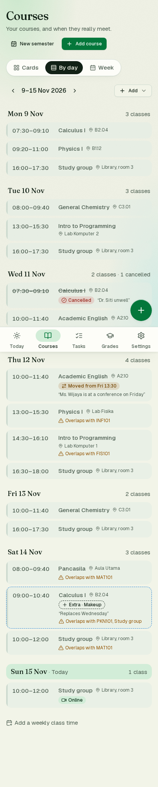

# Folium

A personal student dashboard: courses and the week's real schedule, tasks with deadlines, grades and GPA, attendance, and a customizable **Today** page that answers "what do I need to do today?" at a glance. One student, their own data, their own look.

<p>
  
</p>

| Courses by day | Week | On a phone |
|---|---|---|
|  |  |  |

Screenshots are of the demo account (`bun run screenshots`).

## What it does

- **Today**: the class on now or next with a live countdown, today's timeline, the week at a glance, tasks due soon and overdue, grades, a "Did you go?" attendance prompt. Widgets can be shown, hidden and reordered.
- **Courses and schedule**: course cards, a time-first list by day, or the week grid. Weekly class times stay the default; a class can be cancelled, moved or change room for one date (or from now on), extra sessions and breaks (holidays, exam weeks) are one tap, and every view shows the same changes. Typed changes in Ctrl/⌘K: "cancel physics tomorrow". Export to Google/Apple Calendar (.ics), semester rollover.
- **Tasks**: one-line quick add that understands "Essay outline tomorrow 5pm #ING101 !high", deadlines with optional time, steps, filters, and inline complete / reschedule / rename, each with Undo.
- **Grades and attendance**: weighted assessments, grade so far, "what do I need for an A?", credit-weighted GPA per semester, attendance against your campus's minimum.
- **Personal**: light/dark/system, colour presets or your own accent, font, density, motion; settings apply as you change them. Installable as an app.
- **Private and accessible**: every row is protected by Postgres row-level security; every page is checked with axe (WCAG 2.2 AA) in light and dark mode.

## Stack

Next.js 16 (App Router, Cache Components) · React 19 · strict TypeScript · Supabase (Postgres + RLS, Auth, pgTAP) · Tailwind CSS v4 with CSS-variable theme tokens · Zod v4 · `@date-fns/tz` · dnd-kit · Biome · Vitest · Playwright + axe · GitHub Actions.

## Setup

Requires [Bun](https://bun.sh), Docker and Node 20+.

```bash
bun install
bunx supabase start            # local Postgres, Auth, Studio and Mailpit
cp .env.example .env.local     # fill in the URL and PUBLISHABLE_KEY from `bunx supabase status`
bunx supabase db reset         # apply migrations and load the demo data
bun dev                        # http://127.0.0.1:3000
```

Sign in as **`demo@folium.test` / `folium-demo-2026`**, or create an account (confirmation emails land in Mailpit at http://127.0.0.1:54324). More, including hosted Supabase setup: [docs/local-development.md](docs/local-development.md).

## Tests

```bash
bun run typecheck              # route types + tsc
bunx biome check .             # lint and format
bun run test                   # unit tests (Vitest): dates, deadlines, the schedule merge, parsers, grades…
bunx supabase test db          # database tests (pgTAP): row-level security, constraints, triggers
bun run test:e2e               # end to end (Playwright, desktop + mobile); needs Supabase and a running app
bun run db:seed && bun run test:a11y   # accessibility matrix (axe) as the demo account
```

The first four must pass before any change is finished.

## Docs

- [MAP.md](MAP.md): where everything is, feature by feature, and how to add a widget, setting, table, page or form.
- [docs/architecture.md](docs/architecture.md): how it fits together and the rules (data and security, auth, dates and time zones, forms and actions, testing).
- [docs/decisions/](docs/decisions/README.md): why things are the way they are (backend and frontend, plus open decisions).
- [docs/gotchas.md](docs/gotchas.md): traps that already cost time once.
- [docs/security-review.md](docs/security-review.md): what was audited and found.
- [docs/development/Folium-V1.md](docs/development/Folium-V1.md): the original product plan.
