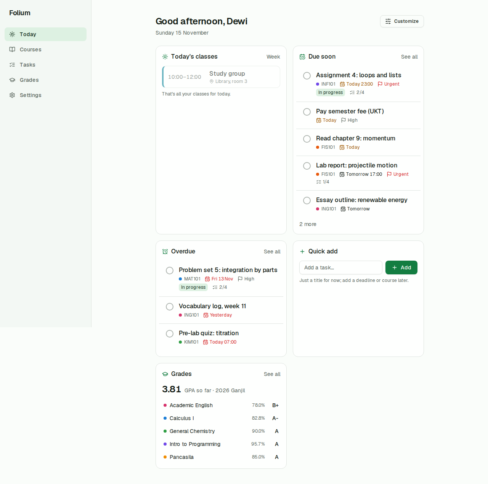
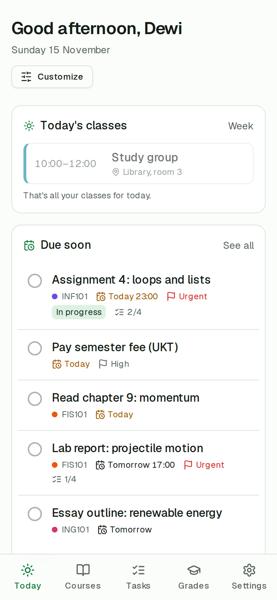
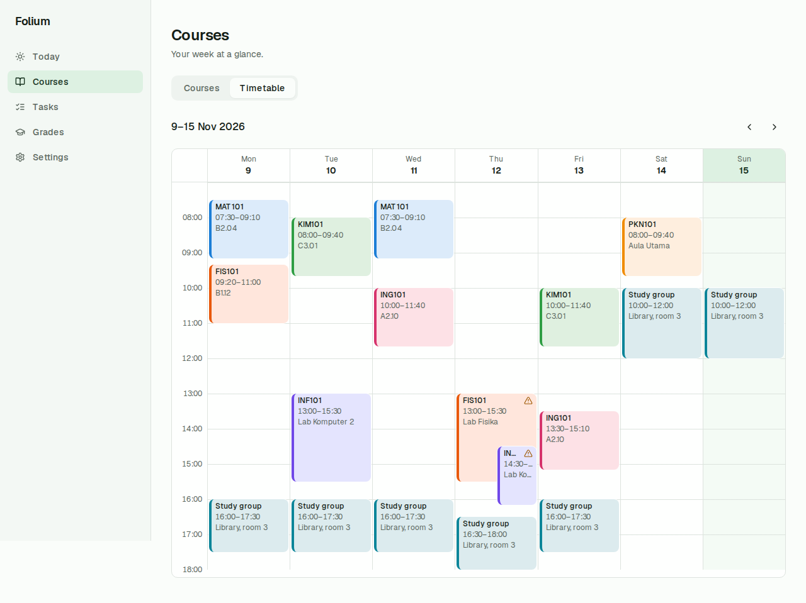
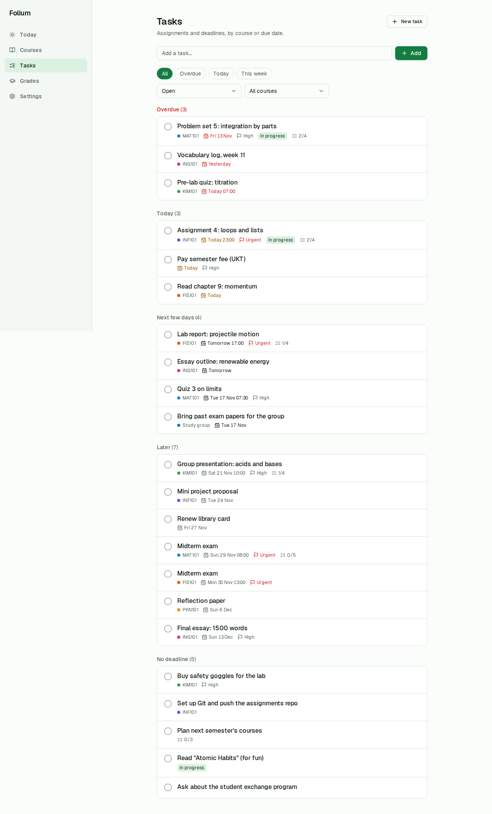
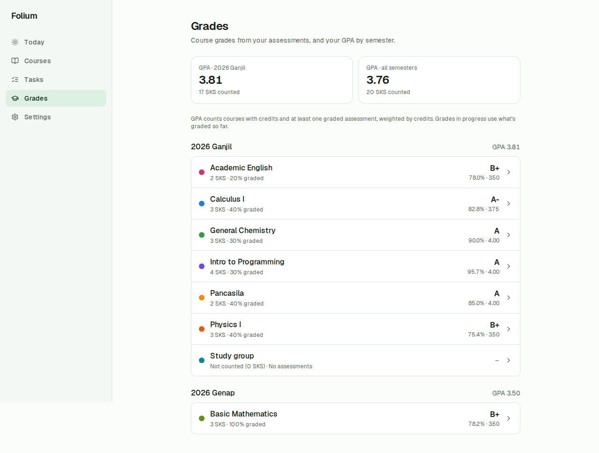
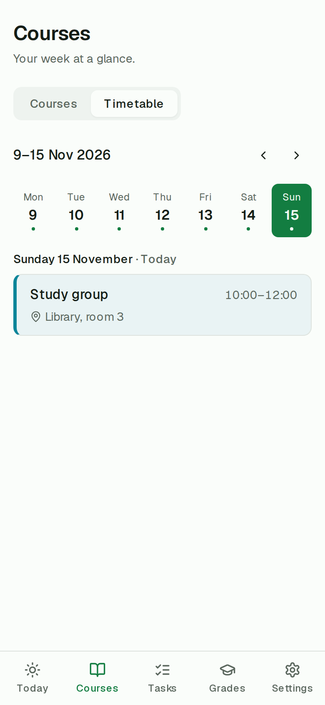
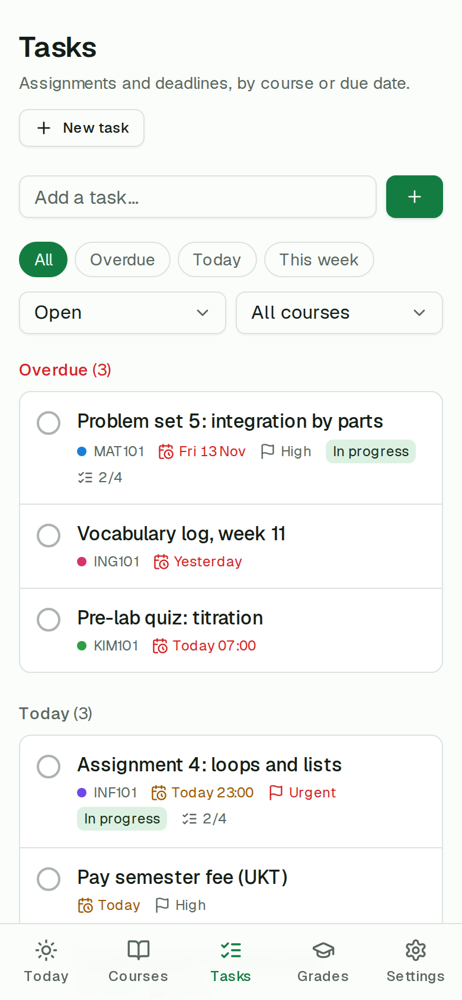
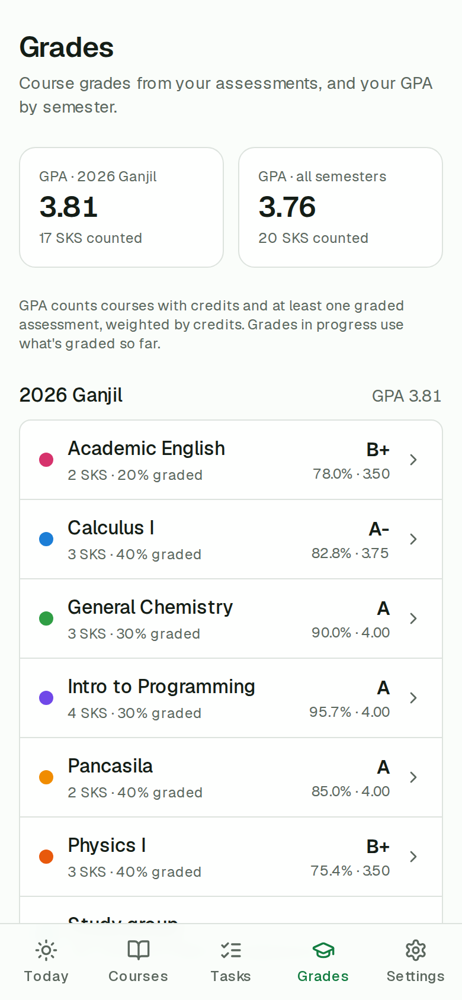

# Folium

A personal student dashboard: courses, a weekly timetable, tasks with deadlines, grades and GPA, and a customizable **Today** page that answers "what do I need to do today?" at a glance. One student, their own data, their own look.

<p>
  
  
</p>

| Timetable | Tasks | Grades |
|---|---|---|
|  |  |  |
|  |  |  |

Screenshots are generated from the demo account with `bun run screenshots`.

## Features

- **Today dashboard**: greeting, today's classes with "Now"/"Next", tasks due soon, overdue tasks, quick add, grades. Show, hide and reorder widgets (drag, keyboard or up/down buttons); each widget loads and fails on its own.
- **Courses and timetable**: courses with colour, lecturer, room, semester and credits; weekly class times with optional date ranges; a day-by-day agenda on phones and a week grid on desktop. Overlapping classes are allowed and flagged.
- **Tasks and deadlines**: due date with optional time, priority, status, course, notes and a checklist of steps. Filter by overdue / today / this week, status and course; quick add with just a title.
- **Grades**: assessments per course (weight, score out of any maximum), grade so far, "what do I need on the rest for an A?", and credit-weighted GPA per semester and overall, on a customizable grade scale (default: Indonesian 4.0).
- **Personal by design**: light/dark/system mode, five colour presets or a custom accent, font and density, all applied on the first paint. Time zone, week start, 12/24-hour time.
- **Private and secure**: every row belongs to one user and is protected by Postgres RLS; email sign-up with confirmation; password reset without account enumeration; security headers. See the [security review](docs/documentation/security-review.md).
- **Accessible**: every page is checked with axe (WCAG 2.2 AA) in light and dark mode across all colour presets.

## Stack

| | |
|---|---|
| App | Next.js 16 (App Router, Cache Components), React 19, strict TypeScript |
| Data and auth | Supabase: Postgres with Row Level Security, Auth (email + password), pgTAP tests |
| UI | Tailwind CSS v4 with CSS-variable theme tokens (`light-dark()`), shadcn/ui-style components, dnd-kit, lucide icons |
| Validation and dates | Zod v4 at every boundary; `@date-fns/tz` for time zones |
| Quality | Biome, Vitest, Playwright + axe, GitHub Actions (typecheck, lint, unit, DB, e2e) |

## Getting started

Requires [Bun](https://bun.sh) and Docker.

```bash
bun install
bunx supabase start            # local Postgres, Auth, Studio and Mailpit
cp .env.example .env.local     # fill in API_URL and PUBLISHABLE_KEY from `bunx supabase status`
bunx supabase db reset         # apply migrations and load the demo data
bun dev                        # http://127.0.0.1:3000
```

Sign in with the demo account **`demo@folium.test` / `folium-demo-2026`**, or create an account: confirmation and password-reset emails land in Mailpit at http://127.0.0.1:54324.

| Command | |
|---|---|
| `bun dev` | Dev server |
| `bun run build` / `bun run start` | Production build / serve |
| `bun run typecheck` | Route types + `tsc` |
| `bun run lint` / `bun run format` | Biome |
| `bun run test` | Unit tests (Vitest) |
| `bun run test:db` | Database tests (pgTAP: RLS, constraints, triggers) |
| `bun run test:e2e` | End-to-end + accessibility tests (Playwright; needs Supabase and a running app) |
| `bun run db:types` | Regenerate `src/types/database.ts` after a schema change |
| `bun run db:seed` | Rebuild the demo account |
| `bun run screenshots` | Regenerate the README screenshots |

Deploying to a hosted Supabase project needs a few dashboard settings (email templates, secure password change, redirect URLs); see [local development](docs/documentation/02-local-development.md#setting-up-a-hosted-supabase-project).

## Architecture

```
src/app/            routes and layouts only (thin)
src/features/       one folder per feature: auth, settings, courses, timetable, tasks, grades, dashboard
                    each with schema.ts (Zod), queries.ts (reads), actions.ts (server actions),
                    pure logic + tests, and components/
src/components/     app shell and shared UI
src/lib/            dates/time zones, env, Supabase clients, helpers
supabase/           migrations, pgTAP tests, seed, email templates, local config
e2e/                Playwright + axe tests
```

- **Security lives in the database.** Every table has RLS policies scoped to `auth.uid()`, and child rows use composite foreign keys `(parent_id, user_id)`, so one user can never read or reference another's data, even with a forged id.
- **Reads and writes go through each feature's data layer.** Components never call Supabase; server actions validate with Zod, re-check identity and return `{ ok, error }`.
- **Theme on the first paint.** The root layout reads the user's settings and puts the theme on `<html>` as data attributes; every colour derives from one hue in CSS. No flash, no client script.
- **Customization is data.** Settings and the dashboard layout are JSON storing only the user's overrides, merged over defaults on read, so new options and widgets reach existing users without migrations.
- **Time zones are explicit.** "Today", week boundaries and date-only deadlines are computed in the user's time zone with pure, tested functions.
- **Pure logic is tested hardest**: due dates, timetable overlaps, week layout, dashboard layout merging, grades and GPA.

The full documentation starts at **[docs/documentation/00-start-here.md](docs/documentation/00-start-here.md)**: architecture, a file-by-file map, database, every feature, the form/action pattern, testing, recipes, gotchas and the decision log.

## Status

Stages 1–6 of the [v1 plan](docs/development/Folium-V1.md) plus grades are done. Next: deploy.
